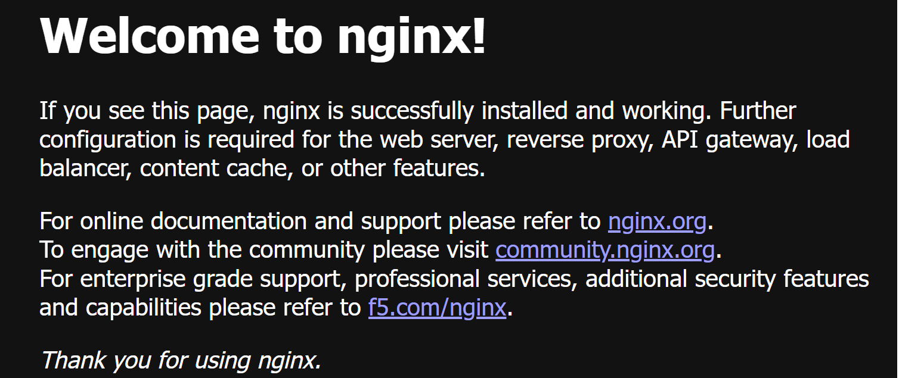

# 06 - Automated Docker Deployment on EC2

## Overview
Automated bootstrapping of an EC2 instance running a containerized application upon launch.

## Concepts Covered
- EC2 `user_data` bash script execution
- Automatic Docker installation and daemon startup
- Deploying containerized web application (`nginxdemos/hello`)
- Inbound HTTP Security Group configuration (Port 80)

## How to Run
```bash
terraform init
terraform plan
terraform apply
```

## Proof of Execution

